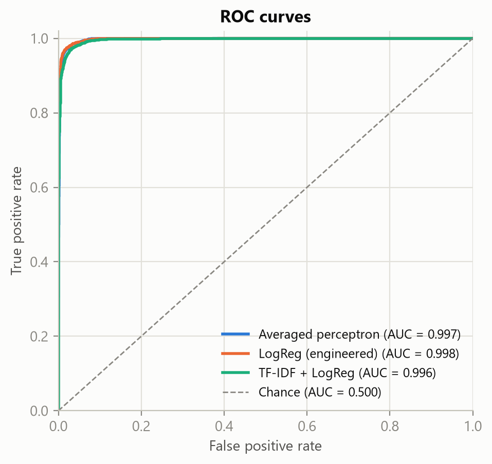
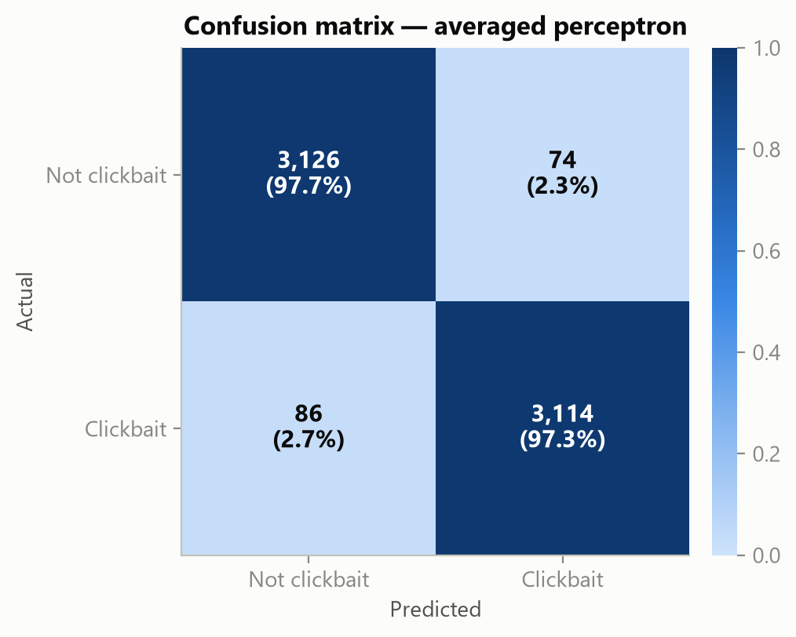
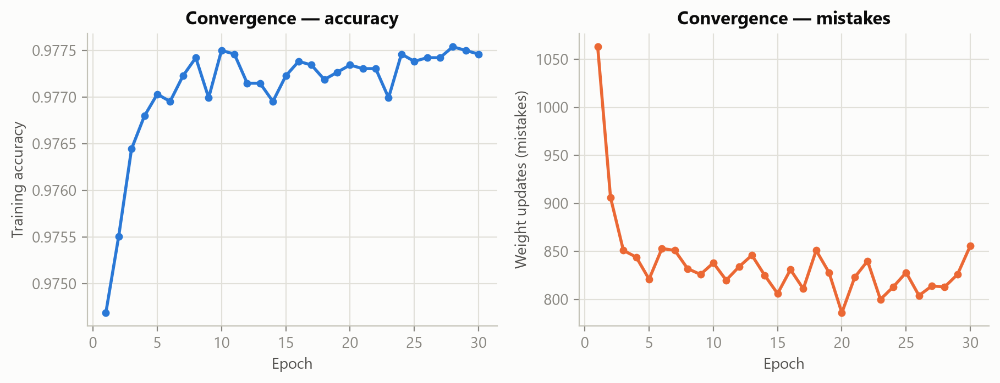
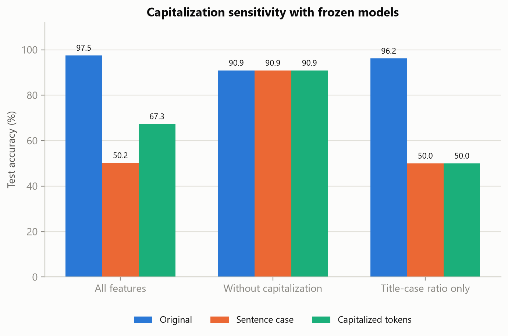
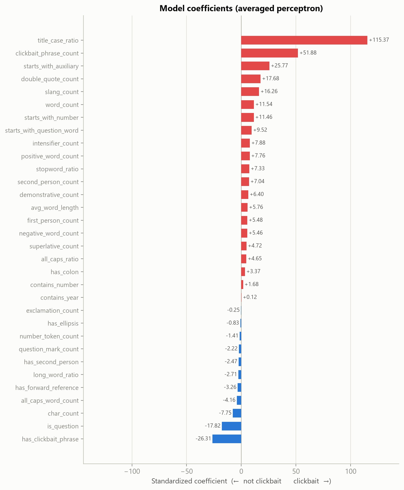

<p align="center">
  
</p>

<h1 align="center">Universiteti i Prishtinës</h1>

<h2 align="center">Fakulteti i Inxhinierisë Elektrike dhe Kompjuterike</h2>

<p align="center">
  Programi i Studimeve: Inxhinieri Kompjuterike dhe Softuerike – Master<br>
  Lënda: Procesimi i Gjuhëve Natyrale (NLP)<br>
  Viti akademik: 2026/27
</p>

<br>

<h1 align="center">Perceptron-Based Text Classification for Detecting Clickbait Headlines</h1>

<br>

<h2 align="center">Profesori</h2>

<p align="center">Prof. Asst. Dr. Mërgim H. Hoti</p>

<h2 align="center">Studentët</h2>

<p align="center">
  Arton Gërguri<br>
  Jon Klinaku
</p>

<br>

---

## Abstrakt

Ky projekt studion zbulimin e titujve *clickbait* me një perceptron të mesatarizuar të implementuar nga e para në NumPy dhe 32 veçori leksikore e stilistike të emërtuara. Në korpusin *Stop Clickbait* me 32,000 tituj, modeli arrin 97.50% saktësi dhe 0.9969 ROC-AUC. Regresioni logjistik me të njëjtat veçori arrin 97.59%, ndërsa baza lineare TF-IDF arrin 96.89%. Krahasimi në pesë ndarje të të dhënave të trajnimit dhe eksperimentet me ndryshimin e shkronjave të mëdha e bëjnë vlerësimin më të plotë: saktësia e perceptronit bie në 50.17% kur titujt e testimit kthehen në stil fjalie, ndërsa modeli pa veçori kapitalizimi arrin 90.89%. Peshat dhe kontributet për çdo titull shpjegojnë sjelljen e modelit, por veçoritë e ndërlidhura kërkojnë interpretim të kujdesshëm. Rezultatet përshkruajnë këtë korpus dhe nuk provojnë përgjithësim te burime të reja.

| Modeli | Veçori | Saktësia | Precision | Recall | F1 | ROC-AUC |
|---|---:|---:|---:|---:|---:|---:|
| Perceptron i mesatarizuar (ynë) | 32 | 0.9750 | 0.9768 | 0.9731 | 0.9750 | 0.9969 |
| Regresion Logjistik (të njëjtat veçori) | 32 | 0.9759 | 0.9745 | 0.9775 | 0.9760 | 0.9977 |
| TF-IDF + Regresion Logjistik | 20,000 | 0.9689 | 0.9741 | 0.9634 | 0.9687 | 0.9957 |

---

## Motivation

*Clickbait* headlines open a "curiosity gap" to attract clicks. This project asks
how well a small set of named linguistic and stylistic features can support a
linear classifier, and what its predictions reveal about the dataset. An averaged
perceptron provides the from-scratch learning component; logistic regression on
the same features separates feature quality from the choice of classifier.
TF-IDF + logistic regression supplies a high-dimensional linear text baseline
whose word/ngram coefficients are also inspectable.

## Dataset

The *Stop Clickbait* corpus (Chakraborty et al., 2016): 32,000 English
headlines, each labelled `1` (clickbait) or `0` (not clickbait).

| Property | Value |
|---|---|
| Total headlines | 32,000 |
| Clickbait / Not | 15,999 / 16,001 (balanced) |
| Avg. words/headline | 9.07 (range 1–26) |
| Train / Test split | 25,600 / 6,400 (stratified, seed 42) |

The CSV lives at [`data/clickbait_data.csv`](data/clickbait_data.csv) and stores
only `headline` and `clickbait`. Source, timestamp, and article-body metadata are
unavailable, so this repository cannot evaluate source-held-out or temporal
generalization from the supplied file alone.

## Engineered features

32 named features across 12 linguistic families
([`src/features.py`](src/features.py)):

| Family | Example features |
|---|---|
| Numeric / listicle | `starts_with_number`, `contains_year` |
| Reader address | `second_person_count`, `first_person_count` |
| Forward reference | `demonstrative_count`, `has_forward_reference` |
| Clickbait phrases | `clickbait_phrase_count` |
| Interrogative | `is_question`, `starts_with_question_word` |
| Hyperbole | `superlative_count`, `intensifier_count` |
| Punctuation | `exclamation_count`, `has_ellipsis` |
| Length | `word_count`, `avg_word_length` |
| Capitalization | `title_case_ratio`, `all_caps_ratio` |
| Informal register | `slang_count` |
| Affect | `positive_word_count`, `negative_word_count` |
| Function words | `stopword_ratio` |

Phrase matching respects word boundaries, common apostrophe variants are
normalized, and superlatives use an explicit lexicon. Affect uses separate
positive and negative counts; their redundant total is omitted.

Features are standardized using training data only. This puts coefficients on a
shared scale, but correlated features can still redistribute their magnitudes and
signs. Coefficients describe the fitted model's conditional score changes.

## Model: averaged perceptron (from scratch)

[`src/perceptron.py`](src/perceptron.py) implements the averaged perceptron
(Freund & Schapire, 1999) in NumPy, with:

- the efficient cached-accumulator averaging trick (no storing of every iterate),
- convergence detection (a full mistake-free pass),
- a scikit-learn-style API (`fit` / `predict` / `decision_function` / `score`).

Averaging combines successive parameter vectors while preserving linear
predictions and their additive feature contributions.

## Results

The table above reports the same 6,400-headline held-out test set for all three
models. Both engineered-feature models score highly on this corpus. The
same-feature logistic-regression control is within 0.1 percentage points of the
perceptron; this run does not establish general superiority of either classifier.
Machine-readable values are in [`results/model_comparison.csv`](results/model_comparison.csv).

All models also use the **same five stratified validation folds within the 25,600
training headlines**. The test partition is excluded from every fold. Each fold
fits a fresh scaler or TF-IDF vocabulary on its training subset only. Settings are
fixed (`30` perceptron epochs, logistic regression `C=1.0`, seed `42`); no
hyperparameter search is performed.

| Model | Validation accuracy (mean ± fold SD) | Validation ROC-AUC (mean ± fold SD) |
|---|---:|---:|
| Averaged perceptron, 32 features | 0.9769 ± 0.0006 | 0.9975 ± 0.0001 |
| Logistic regression, same 32 features | 0.9766 ± 0.0010 | 0.9978 ± 0.0003 |
| TF-IDF + logistic regression | 0.9660 ± 0.0030 | 0.9947 ± 0.0004 |

Fold standard deviations describe these splits; they are not confidence intervals.
All per-fold scores are retained in [`results/metrics.json`](results/metrics.json).
Reference-variant test accuracies are vanilla `0.9708`, averaged `0.9750`, and
scikit-learn `Perceptron` `0.9650`; these comparisons supplement the unit tests.

<div align="center">






</div>

## Capitalization ablation and robustness

Each feature variant is trained on the original training headlines. Its scaler
and model then stay frozen while the same held-out texts and labels are evaluated
in three forms: original, sentence case (`str.capitalize()`), and capitalized token
initials (the remaining characters, including contractions, are preserved).

| Perceptron features | Original | Sentence case | Capitalized token initials |
|---|---:|---:|---:|
| All 32 | 97.50% | 50.17% | 67.34% |
| Without capitalization (29) | 90.89% | 90.89% | 90.89% |
| `title_case_ratio` alone (1) | 96.17% | 50.00% | 50.00% |

The large change measures dependence on typography. The 29-feature variant trades
some in-corpus accuracy for invariance to these casing changes. This controlled
stress test does not measure performance on new publishers. Full metrics and
prediction-change counts are in
[`results/capitalization_robustness.csv`](results/capitalization_robustness.csv).

<div align="center">

</div>

## Interpreting model coefficients

The following are the largest positive and negative coefficients in the fitted
perceptron, conditional on its other inputs. Their signs describe score changes
within this model, rather than independent or causal linguistic effects.
The full list is in [`results/feature_weights.csv`](results/feature_weights.csv).

| Positive coefficient | Weight | Negative coefficient | Weight |
|---|---:|---|---:|
| `title_case_ratio` | +115.37 | `has_clickbait_phrase` | −26.31 |
| `clickbait_phrase_count` | +51.88 | `is_question` | −17.82 |
| `starts_with_auxiliary` | +25.77 | `char_count` | −7.75 |
| `double_quote_count` | +17.68 | `all_caps_word_count` | −4.16 |
| `slang_count` | +16.26 | `has_forward_reference` | −3.26 |

<div align="center">

</div>

[`results/weight_stability.csv`](results/weight_stability.csv) reports each
coefficient's mean, standard deviation, and sign agreement across training folds,
relative to the full-training fit. For example, `exclamation_count` changes sign
in all five folds, while `contains_year` and `has_ellipsis` agree in four of five.
This illustrates why a single coefficient ranking needs qualification. Each fold
uses its own training scale; these summaries are descriptive, not confidence
intervals. See also scikit-learn's
[coefficient interpretation guide](https://scikit-learn.org/stable/auto_examples/inspection/plot_linear_model_coefficient_interpretation.html).

Individual predictions use `contribution = standardized_value × coefficient`.
The report includes the bias and the sum of omitted contributions, so truncated
explanations still reconstruct the complete decision score. Class-mean plots use
standardized values to avoid favoring features measured in larger raw units.

## Project structure

```text
clickbait-perceptron/
├── assets/
│   └── up-logo.png                # university logo
├── data/
│   └── clickbait_data.csv          # Stop Clickbait corpus (32k headlines)
├── docs/
│   ├── paper.html                 # IEEE-style paper with print layout
│   └── Perceptron-Based Text Classification for Detecting Clickbait Headlines.pdf
├── results/                       # saved experiment outputs
│   ├── capitalization_robustness.csv # casing stress-test metrics and prediction changes
│   ├── feature_weights.csv        # ranked perceptron feature weights
│   ├── metrics.json               # configuration, provenance, metrics, explanations
│   ├── model_comparison.csv       # held-out comparison of three models
│   ├── run_log.txt                # saved console output from a pipeline run
│   ├── weight_stability.csv       # training-fold coefficient summaries
│   └── figures/
│       ├── capitalization_robustness.png
│       ├── class_feature_means.png # standardized feature averages by class
│       ├── confusion_baseline.png
│       ├── confusion_engineered_logreg.png
│       ├── confusion_perceptron.png
│       ├── convergence.png         # training progress
│       ├── feature_weights.png
│       └── roc_curves.png          # three-model comparison
├── src/
│   ├── __init__.py                # source package marker
│   ├── baselines.py               # TF-IDF + Logistic Regression baseline
│   ├── data_loader.py             # CSV loading and stratified train/test split
│   ├── evaluate.py                # metrics, cross-validation, evaluation plots
│   ├── experiments.py             # paired validation and casing experiments
│   ├── features.py                # 32 named linguistic features
│   ├── interpret.py               # coefficient stability and headline explanations
│   ├── perceptron.py              # vanilla and averaged perceptron in NumPy
│   ├── plotting_style.py          # shared, colorblind-safe figure style
│   └── preprocessing.py           # casing/punctuation-preserving cleaning
├── tests/
│   ├── __init__.py                # test package marker
│   ├── conftest.py                # project import path setup for pytest
│   ├── test_experiments.py        # fold isolation and frozen-model protocols
│   ├── test_features.py           # feature extraction and edge cases
│   ├── test_main.py               # report generation and training-only validation
│   ├── test_perceptron.py         # training, predictions, and model contract
│   ├── test_pipeline.py           # evaluation, interpretation, baseline, plots
│   └── test_preprocessing.py      # text cleaning and tokenization
├── .gitignore                     # Python, environment, and editor exclusions
├── LICENSE                        # MIT license
├── main.py                        # command-line entry point for the pipeline
├── README.md                      # project overview and usage
└── requirements.txt               # runtime and test dependencies
```

[`main.py`](main.py) loads the dataset from `data/`, runs the components in
`src/`, and writes metrics, feature weights, and figures to `results/`.
The saved results are tracked in the repository; `docs/` contains the paper's
HTML source and PDF version.

## Installation & usage

```bash
# 1. (optional) virtual environment
python -m venv .venv && source .venv/bin/activate   # Windows: .venv\Scripts\activate

# 2. dependencies
pip install -r requirements.txt

# 3. run the full pipeline (train, evaluate, compare, explain, plot)
python main.py

# faster run without cross-validation
python main.py --no-cv

# keep a separate set of outputs
python main.py --output-dir results/another-run
```

Outputs are written to `results/` by default. Useful flags: `--epochs`,
`--test-size`, `--seed`, `--folds`, and `--output-dir`. Capitalization experiments
run even with `--no-cv`; fold stability is omitted in that mode. `run_log.txt`
is a saved console transcript, rather than an automatically generated report.

The recorded run uses Python 3.12.10, NumPy 2.5.4, pandas 3.1.1,
scikit-learn 1.9.1, and Matplotlib 3.11.2. The JSON report records runtime
versions and SHA-256 fingerprints of the dataset and pipeline source. These
support comparison across reruns; `requirements.txt` specifies minimum versions.

## Testing & verification

```bash
pip install pytest
python -m pytest -q
```

Tests cover perceptron convergence on separable data, the binary-only contract,
reproducibility, every feature extractor, degenerate-headline edge cases, metrics,
fold-local transformations, paired model validation, frozen-model stress tests,
complete score explanations, and report generation with and without validation.

## Limitations

- The capitalization experiments show a strong typography shortcut in this
  corpus. Random stratified splits do not establish transfer to publishers with
  different styles; the supplied CSV lacks the metadata needed for source-based
  or temporal splits.
- The corpus has already been examined during feature development. These are
  exploratory in-corpus comparisons, and the held-out stress tests reuse the
  same texts and labels. An independently collected evaluation set remains
  necessary to assess broader generalization.
- Correlated features can change coefficient signs or share effects. Fold sign
  agreement measures observed stability rather than causal importance.
- Lexicons are English- and period-specific; features are headline-only (no article
  body). These are discussed in §VIII of the paper.

## References

1. A. Chakraborty, B. Paranjape, S. Kakarla, N. Ganguly. *Stop Clickbait: Detecting and Preventing Clickbaits in Online News Media.* ASONAM, 2016.
2. F. Rosenblatt. *The perceptron: a probabilistic model for information storage and organization in the brain.* Psychological Review, 1958.
3. Y. Freund, R. E. Schapire. *Large margin classification using the perceptron algorithm.* Machine Learning, 1999.
4. M. Collins. *Discriminative training methods for HMMs: perceptron algorithms.* EMNLP, 2002.
5. F. Pedregosa et al. *Scikit-learn: Machine Learning in Python.* JMLR, 2011.

## License

Released under the [MIT License](LICENSE). Dataset © its original authors
(Chakraborty et al., 2016), used here for academic purposes.
